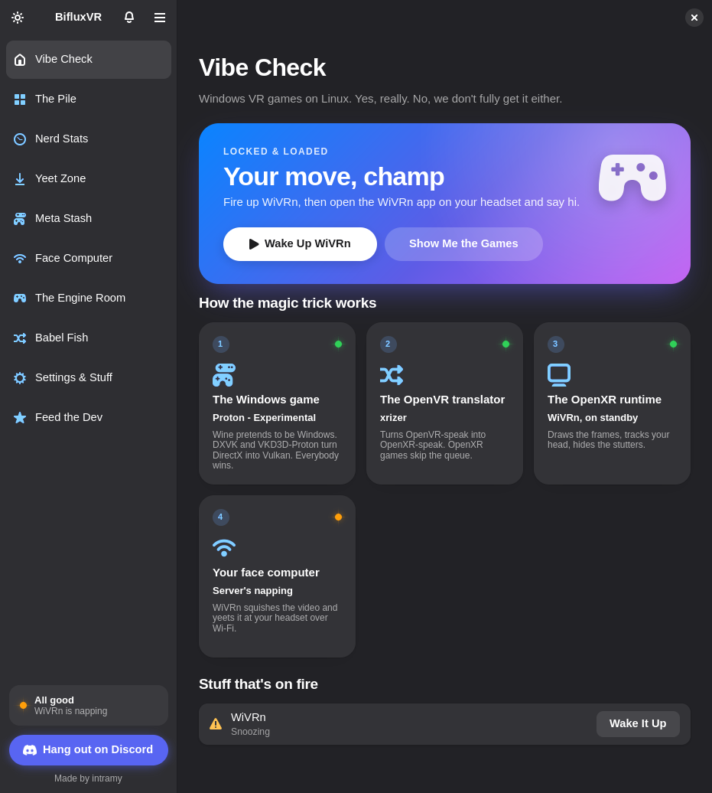
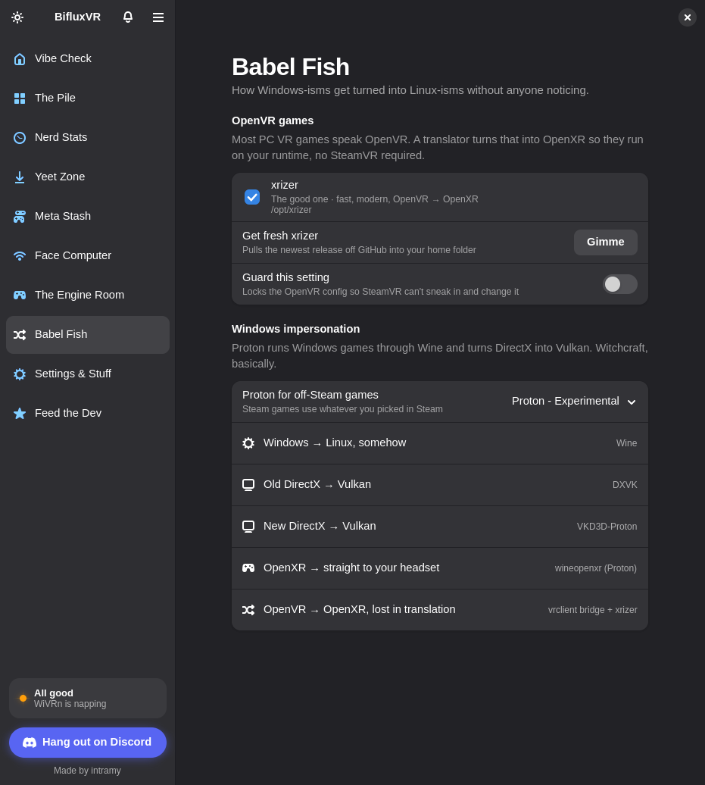
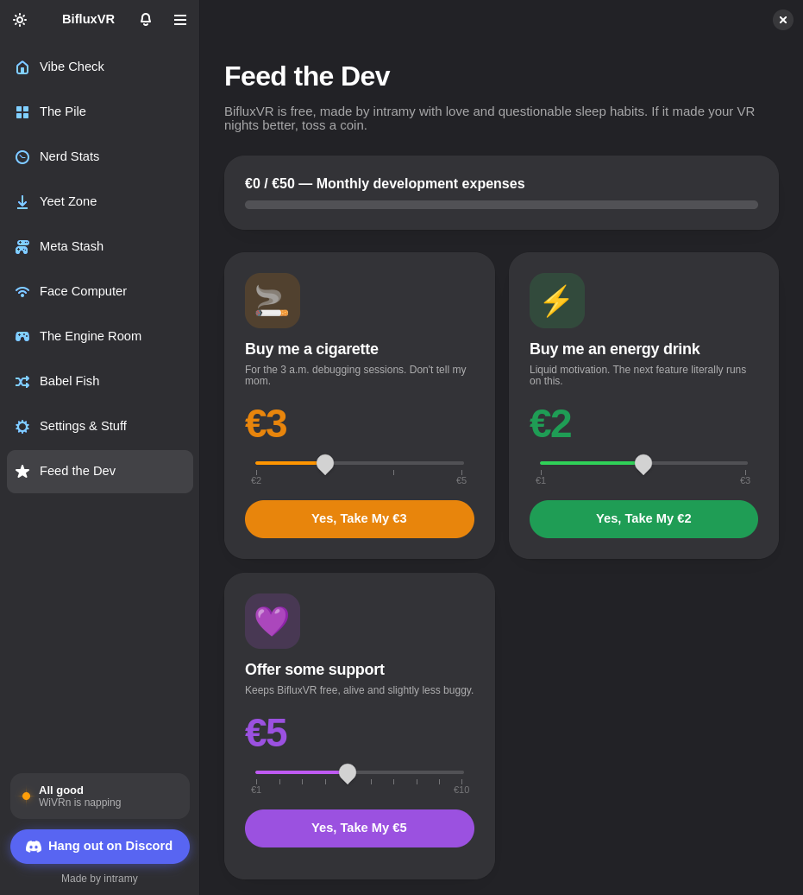

# BifluxVR

*Made by intramy*

[](https://discord.gg/U9XQ9eeGkx)

Play Windows VR games on Linux. BifluxVR is a native GTK 4 / libadwaita app that
sets up, checks and launches the fastest VR translation stack available on
Linux today:

```
Windows game ──► Proton (Wine)            Win32 → Linux
                 DXVK / VKD3D-Proton       Direct3D 9–12 → Vulkan
             ┌─► wineopenxr                OpenXR games → native runtime
             └─► vrclient bridge + xrizer  OpenVR games → OpenXR
                         │
                         ▼
                 WiVRn / Monado            native OpenXR runtime + compositor
                         │
                         ▼
                      Headset
```

SteamVR is not in the path, which removes a whole compositor and runtime from
every frame.

<p align="center">
  
  
  
</p>

## Why BifluxVR

- **No SteamVR in the way.** Games go through Proton, xrizer and WiVRn or Monado,
  with one less compositor and runtime in every frame.
- **From nothing to playing.** The graphical installer sets up what your distro
  is missing, and Play starts the streaming server, sets the runtimes and launches
  the game.
- **It tells you what's wrong before you strap in.** Health checks come with
  one-click fixes, and each game gets its own check, ProtonDB rating, anti-cheat
  warning and frame-rate estimate.
- **Your games and apps, wherever they came from.** It finds your Steam library,
  takes any Windows `.exe`, unpacks archives, runs installers in their own Wine
  prefix from the Yeet Zone, and downloads the PC games your Meta account owns.
- **Folders and a real Uninstall.** Sort The Pile into your own folders, and remove
  anything from its page along with its saves.
- **Mods without the fear.** Install any `.zip` or `.rar` mod and roll it back
  later. Beat Saber custom songs take one click, and REFramework and UEVR are
  offered where they apply.
- **Streaming settings that suit your PC.** Auto-optimize reads your GPU and
  encoders, and Test stream checks that the result keeps up.
- **The small stuff is handled.** Sound moves to the headset and back, Stop really
  stops the whole game, and you get button remapping, play stats and headset
  battery and connection quality.
- **Careful with your system.** Steam and WiVRn configs are backed up before any
  edit, and every file it touches is [listed below](#files-bifluxvr-touches).
- **Free and open source, and it updates itself.** It also has a sense of humour,
  and Serious mode if you'd rather it didn't.

Questions, bugs or a game that just started working?
[Come say hi on Discord](https://discord.gg/U9XQ9eeGkx).

## Features

- **Library**: finds every installed Steam game across all library folders,
  reads the game files to tell whether each one uses OpenVR, OpenXR or the
  Oculus SDK, and shows Steam's artwork. You can add non-Steam Windows `.exe`
  files too; BifluxVR matches them to their Steam store page for cover art
  and ratings (fix a wrong match on the game's page). Cards show play time,
  and the library sorts by name, recently played or most played.
- **Per-game health check**: each game's page checks its files, VR API,
  anti-cheat, Proton prefix, launch options, OpenVR route, mod DLLs and the
  last launch log, with one-click fixes where there is one.
- **Compatibility ratings**: the game's ProtonDB tier and trend, plus your own
  Works / Has issues / Broken rating.
- **Anti-cheat warnings**: games whose anti-cheat blocks Linux get a red badge,
  using AreWeAntiCheatYet's list. BifluxVR tells you, and won't try to get
  around it.
- **Mods & VR fixes**: install any mod from a `.zip` or `.rar` into the game
  folder. Files it replaces are backed up and files it adds are recorded, so
  **Roll Back** restores the folder exactly. Also offered where they apply:
  REFramework (full VR for Resident Evil 2, 3, 4, 7 and Village) and UEVR
  (VR for flat Unreal Engine games, run inside the game's own Wine prefix).
  DLL overrides a mod needs are passed at launch, or added to Steam's launch
  options for Steam games.
- **Beat Saber custom songs**: one click installs BSIPA, SongCore and what they
  need for your game version from BeatMods, and all of it can be rolled back.
- **Button remapper**: for OpenVR games with SteamVR Input bindings, swap
  A/B, X/Y, trigger/grip or the two sticks. Turning every swap off restores
  the game's original binding files.
- **Headset**: live status from WiVRn (connection, headset model, bitrate,
  refresh rate, codecs, hand/eye/face tracking), the battery level through
  adb, and connection quality measured by pinging the headset.
- **Auto-optimize**: detects the GPU and the encoders your WiVRn build
  actually has, recommends encoder, codec, bitrate, resolution scale and
  refresh rate, and writes the encoder to WiVRn's config. **Test stream**
  encodes test video at the headset's resolution and, when the recommended
  encoder can't keep up, tries the alternatives and offers the first that
  does.
- **Frame-rate estimate**: each game's page guesses the frame rate you'll
  get, from the GPU its Steam page asks for, your GPU, your headset's
  resolution and refresh rate, and the Test stream's encoder result. While
  you play, BifluxVR records GPU load and video memory, and the estimate
  switches to what was measured.
- **Stats**: every session started from BifluxVR is recorded with its
  length, headset, bitrate and battery use: totals, a 14-day chart, most
  played games and recent sessions.
- **Self-update**: Settings shows the installed version and checks for a
  newer BifluxVR. **Update** downloads the release, checks it is the version
  it claims to be, runs its `install.sh` and offers a restart.
- **Notifications**: a bell in the sidebar (and desktop notifications) for
  new BifluxVR, WiVRn and xrizer releases, and for Proton or GE-Proton releases whose
  notes mention a game in your library.
- **Stop button**: while a game runs, Play turns into Stop. After a warning
  that unsaved progress is lost, it kills the game and everything it
  started (Wine, Proton, the Steam Runtime container).
- **Sound switching**: during VR games the sound output moves to WiVRn as
  soon as the headset connects, and moves back when the game ends or is
  stopped: to the output picked in Settings → Sound, or automatically to
  headphones first, then speakers.
- **One-click play**: starts the streaming server, makes sure the OpenXR and
  OpenVR runtimes are set, and launches the game through Steam (or through
  umu-launcher/Proton for non-Steam games).
- **Launch options**: writes the variables a game needs to reach the runtime
  from inside Steam's container straight into Steam's config, after making a
  timestamped backup. You can also copy them to paste in yourself.
- **Runtime**: switches the active OpenXR runtime, starts and stops
  WiVRn/Monado, and opens the WiVRn dashboard.
- **Translation**: picks xrizer, OpenComposite or SteamVR for OpenVR games,
  keeps WiVRn's `openvr-compat-path` in sync, can lock the setting against
  SteamVR, downloads the latest xrizer, and selects the Proton build for
  non-Steam games.
- **Settings**: health checks with one-click fixes, switches for the online
  lookups and update notifications, the Auto / Day / Night
  theme (the sun/moon button at the top of the sidebar switches quickly), and
  **Serious mode**. By default the app talks like a human with jokes; Serious
  mode switches every label and message to plain, professional wording.
- **Drop Folder**: drop game `.zip`, `.rar` or `.7z` files, or `.exe` and `.msi`
  installers (or choose them, or search a folder by name). RAR needs
  `unrar` for full support, including solid and multi-part archives (drop any
  part and BifluxVR starts from part 1); `bsdtar` works as a basic fallback.
  Password-protected archives aren't supported. Unpack those yourself and add
  the `.exe` with **+**. Pick **VR** or
  **Simple** and a folder for each type. BifluxVR unpacks every game into its
  own folder, picks the real executable over setup and crash-handler files, and
  adds it to your library. Simple games launch flat, without the VR stack. You
  can switch a game's mode or executable later on its library page.
- **Meta Library**: sign in on Meta's own site (BifluxVR never sees your
  password, you paste the session token) and every PC game on your Meta account
  is listed with what its files say: available (OpenXR), DRM protected (checks
  ownership through the Meta app) or Oculus SDK only. Downloads come straight
  from Meta, are checked file by file, resume after a stop, and land in the
  library. Quest-only games aren't listed; they run on the headset.
  **RiftLift** (by Villagers654) can be installed from the same page: it runs
  Oculus SDK and Meta-platform games on your OpenXR runtime, with up to four
  Meta accounts, side-by-side versions and betas, local Rift `.exe` files,
  Steam games with an Oculus mode and cross-buy games by store link. Meta still
  checks ownership live for the signed-in account; it's not a DRM bypass.
  Installed games show up in the library like any other.
- **Storage**: with more than one drive, a game's page can move it between
  them (SSD1, HDD1 and so on), and the Drop Folder picks the drive new games go to.
- **Donate**: four tiers plus any amount you like, a bar showing this month's
  development expenses, and the Hall of Legends: donators sorted by their total,
  with the name and picture they chose through the Discord bot. Donators get a
  code that unlocks the Gold style and a sidebar badge. Payments happen on
  Revolut in your browser.
- **Looks**: Auto / Day / Night, plus a Classic or Winter style (icy colors and
  snow on the buttons, with snowfall that pauses when the window isn't focused).

## Made with AI help

parts of BifluxVR were made true with the help of claude. Honestly, it's better to say straight up that i vibecoded parts of it rather than getting caught red handed.

## Install

Requires Python 3.10+, PyGObject, GTK 4 and libadwaita ≥ 1.7, plus Steam,
Proton and an OpenXR runtime (WiVRn for Quest/Pico, Monado for wired
headsets). xrizer can be downloaded from inside the app.

```sh
./install.sh               # the graphical installer
./install.sh --files-only  # just copy BifluxVR into ~/.local, no questions
./install.sh --uninstall
```

The installer checks the system (Linux only; Windows, WSL and macOS get
"Unsupported OS"), shows exactly what it read, lists every component with
whether it will be installed, updated or skipped, installs them with the
distribution's package manager (pacman, dnf, apt, zypper or emerge, one
password prompt via pkexec, or sudo where no polkit agent is running) and falls back to Flathub or the official
GitHub release where the distribution has no package. It ends with first
settings and a Launch button. The full log is kept in
`~/.cache/bifluxvr/logs/installer.log`.

Optionally it sends a one-line install report (OS, distribution, kernel,
user number, result) to the developer. It is shown in full before anything
is sent, can be switched off, and goes through the relay in `relay/` so no
secret is in this repository. Reports are off until `RELAY_URL` in
`wizard/report.py` is set.

Run without installing: `python3 -m bifluxvr` from this directory.

### Publishing updates

The updater reads GitHub releases. To ship a version, bump `__version__` in `bifluxvr/__init__.py`,
push, and publish a GitHub release tagged with the same number (`v1.3.0`).
GitHub's source tarball is what gets installed, so nothing needs uploading.

The expenses bar reads `funding.json` from the `main` branch. Edit and push it
to change the total; no release is needed.

## What it can't do

These are limits of the platform, not of the app:

- **Oculus-SDK-only games** (some Oculus Store titles) have no Linux runtime.
  BifluxVR marks them so you know before you try.
- **Meta games that check ownership** through the Meta app (LibOVRPlatform) won't
  start, because the Meta app doesn't run on Linux. BifluxVR won't bypass that.
- **Kernel anti-cheat** games that block Proton won't start.
- **Flat games** with no VR support appear in a virtual desktop screen, not in
  full VR. VR mods such as UEVR are separate projects.
- Steam overwrites its config when it exits, so BifluxVR applies launch options
  only while Steam is closed. Otherwise it offers to copy them for you.
- **Guardian/boundary status** never leaves the headset, so it isn't shown.
- **Battery level** needs adb (`android-tools`) and the headset connected
  with developer mode on; WiVRn doesn't report it.
- **Games using the legacy OpenVR input API** hard-code their buttons and
  can't be remapped from outside the game.
- **UEVR's injector** needs the .NET 6 Desktop Runtime in the game's prefix
  (`protontricks <appid> dotnetdesktop6`) and is experimental under Proton.
- **The stream test** uses ffmpeg's encoders and a synthetic test pattern, so
  treat its numbers as a guide, not a guarantee.

## Online lookups

With **Ratings and artwork** on, BifluxVR asks ProtonDB for ratings and the
Steam store for search results and artwork. With **Update notifications** on,
it reads GitHub releases of BifluxVR, WiVRn, xrizer, Proton and GE-Proton every few
hours. Only game IDs and titles are sent. Both can be switched off in
Settings.

A few things connect only when they're needed:

- **The Feed the Dev page** reads `funding.json` from this repository on GitHub
  every time the app starts.
- **The anti-cheat check** downloads AreWeAntiCheatYet's game list.
- **Beat Saber custom songs** download from BeatMods.
- **Meta Library** sends your session token to Meta, and only to Meta. It's kept
  in `~/.config/bifluxvr/meta-token`, readable only by you.

Like any web request, these show your IP address to the service you reach.

## Files BifluxVR touches

| File | Why |
|---|---|
| `~/.config/openxr/1/active_runtime.json` | Active OpenXR runtime (symlink) |
| `~/.config/openvr/openvrpaths.vrpath` | OpenVR runtime → xrizer |
| `~/.config/wivrn/config.json` | The `openvr-compat-path` key, and `encoder`/`bit-depth` when you apply Auto-optimize (backed up first) |
| `…/Steam/userdata/*/config/localconfig.vdf` | Launch options, backed up first, written only while Steam is closed |
| `~/.config/bifluxvr/`, `~/.cache/bifluxvr/` | BifluxVR settings, your Meta session token if you sign in, scan cache, ratings and artwork cache, notifications, logs |
| `~/.local/share/bifluxvr/sessions.json` | Play sessions |
| `~/.local/share/bifluxvr/mods/` | Installed mod records and the original files they replaced |
| `~/.local/share/bifluxvr/tools/` | Downloaded UEVR and REFramework |
| Game folders | Only when you install a mod or remap buttons; both can be undone |
| `~/Games/BifluxVR/{VR,Simple}` (default) | Archives unpacked from the Yeet Zone |
| `~/Games/BifluxVR/Installed/<name>/` (default) | Anything put there by an installer, along with its own Wine prefix and saves. Uninstall deletes the whole folder |

## Unofficial

BifluxVR is an independent project. It isn't affiliated with or endorsed by
Valve, Meta, Beat Games or anyone else whose software it works with. The Meta
Library uses Meta's unofficial, undocumented access and could stop working at
any time, so use it at your own risk. It only downloads games your account owns.

## License

Copyright (C) 2026 intramy. BifluxVR is free software under the
[GNU GPL version 3](LICENSE) with a few [additional terms](NOTICE): keep the
credit, and don't present a modified version as the original. Forks are welcome
under their own name and icon; see [TRADEMARKS.md](TRADEMARKS.md).

The icon is based on Tux by Larry Ewing, created with The GIMP.
